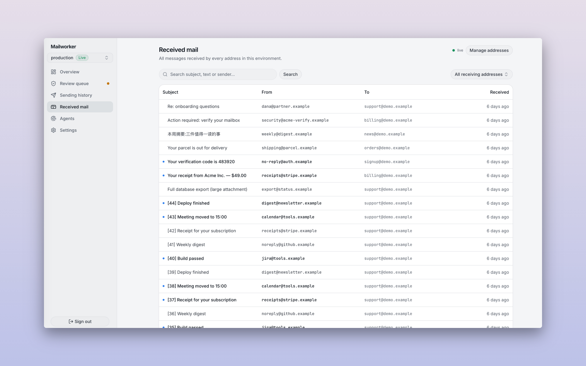

<div align="center">

# Mailworker

### Your products send. Your agents read. You approve.

**A self-hosted email runtime for AI agents, built on Cloudflare Email Service and Workers.**

[简体中文](README.zh-CN.md) · [Quick start](#deploy-with-one-prompt) · [REST API](#connect-your-products) · [CLI](#give-agents-an-inbox)


</div>

Mailworker turns a Cloudflare domain into email infrastructure that both your
products and your AI agents can use. Applications get a Resend-like REST API for
transactional email. Agents get a CLI for creating inboxes, waiting for messages,
reading bodies, drafting replies, and submitting sends for human approval.

One deployment can serve multiple products and domains without a separate
Mailworker subscription for each one. The infrastructure, data, and credentials
stay in **your Cloudflare account**; Cloudflare plan and usage charges still apply.



## Put email operations on an agent loop

| Your need | What Mailworker gives you |
|---|---|
| **Email for every product** | One REST API for transactional send and receive across multiple domains, with attachments, batch sends, webhooks, and delivery timelines |
| **Agent-assisted support** | Agents read untrusted mail as data, draft replies, and submit them to a queue; a human approves the irreversible send in the dashboard |
| **E2E and manual testing** | Create disposable inboxes on your own domain without creating a Cloudflare routing rule for every address; block until the message arrives and read its body |
| **A control plane you own** | Scoped API keys, agent identities, quotas, recipient allowlists, suppression handling, isolated environments, and a sandbox that sends nothing outside |

```text
customer email ──▶ Cloudflare Email Routing ──▶ Mailworker ──▶ Agent reads + drafts
                                                                         │
product API ─────▶ REST API / CLI ────────────▶ policy gates ──▶ human approves
                                                                         │
recipient ◀────── Cloudflare Email Sending ◀── delivery queue ◀──────────┘
```

## Deploy with one prompt

There is no hosted Mailworker account to sign up for. Clone the repository in a
coding-agent session and ask the agent to provision it into your Cloudflare
account:

```bash
git clone https://github.com/guangzhengli/mailworker.git
cd mailworker
pnpm install
```

```text
Deploy this project to my Cloudflare account.
```

The bundled `deploy-mailworker` skill walks through four gated phases —
environment, discovery, plan, and execute. **It changes nothing before you
approve the plan.** The plan covers D1, R2, Queues, a Durable Object, the Worker,
Email Routing, Email Sending, delivery events, DNS, and the bootstrap admin key.

If your agent does not discover repository-local skills automatically, install
the deployment skill explicitly:

```bash
npx skills add guangzhengli/mailworker -s deploy-mailworker
```

You can also read every deployment step in
[`.agents/skills/deploy-mailworker/`](.agents/skills/deploy-mailworker/SKILL.md)
and run it by hand.

## Give agents an inbox

Install the public Mailworker skill in Codex, Claude Code, Cursor, or another
[Agent Skills](https://agentskills.io)-compatible agent:

```bash
npx skills add guangzhengli/mailworker
```

Or use the CLI directly without cloning this repository:

```bash
npx @mailworker/cli@latest help --agent
```

An end-to-end signup test is two operations:

```bash
id=$(mailworker inbox create --prefix signup --ttl 10m --json | jq -r .id)

# Trigger the signup flow, then wait. stdout contains only the body.
BODY=$(mailworker wait --inbox "$id" --text --timeout 60s) || exit $?
```

Creating an inbox is one database insert, not a Cloudflare API call or a new
routing rule. Create one per test, expire it automatically, save a failed message
as raw `.eml`, and replay it through the same ingest path later.

| Command | Purpose |
|---|---|
| `capabilities` | Discover this key's environment, identity, limits and usable actions |
| `inbox create` / `inbox ls` / `inbox rm` | Create and manage ephemeral or persistent addresses |
| `wait` / `tail` | Wait for matching mail or stream new messages |
| `ls` / `get` / `seen` | Search and read stored mail; `--text` prints just the body, `--raw` exports the original MIME |
| `inject` | Replay a captured `.eml` fixture through the real ingest path |
| `send` / `status` | Send through policy gates and inspect the delivery timeline |
| `approve` | Release a send held for a human; agents should not receive this scope |
| `doctor` | Check MX, SPF, DKIM, DMARC, sending status, and bindings |

Every command supports `--json`, never prompts in a non-TTY session, and uses
stable exit codes. In particular, `wait` exits `4` when no matching message
arrives, so agents and CI jobs can branch without parsing prose.

TypeScript applications can use `@mailworker/sdk`. It validates responses at
runtime, supports bounded async pagination and cancellation, and automatically
retries mutations only when an idempotency key makes the retry safe.

## Connect your products

The CLI is a thin client over the same `/v1` REST API your applications use.
Authenticate with a scoped key and call Mailworker from any language:

```bash
curl -sS -X POST "$MAILWORKER_URL/v1/send" \
  -H "Authorization: Bearer $MAILWORKER_TOKEN" \
  -H "Content-Type: application/json" \
  -d '{
    "from": "support@mail.example.com",
    "to": ["customer@example.com"],
    "subject": "We received your request",
    "text": "A human will follow up shortly.",
    "idempotencyKey": "ticket-1842-reply-1"
  }'
```

The `202` response contains a delivery ID, not a promise that the message was
delivered. Query `GET /v1/send/:id` for the event timeline, or subscribe to
signed webhooks. Use `POST /v1/inboxes` to create product-specific or temporary
addresses and `GET /v1/messages/wait` to long-poll for incoming mail.

See the complete [REST API reference](skills/mailworker/references/rest-api.md).

## Human approval is a security boundary

An agent can read an email, write a reply, and call `send`, while its identity is
configured with `require-approval`. The delivery stops in `pending_approval`
until a different principal approves it in the dashboard or through a credential
with `message:approve`.

That separation is deliberate:

- The sending agent gets quotas, recipient allowlists, and only the scopes it needs.
- The agent does **not** get `message:approve`; it cannot approve its own work.
- Idempotency keys prevent a retry from sending the same message twice.
- Loop detection, suppression handling, and per-identity policy gates run before dispatch.
- Incoming email is always untrusted data. `trusted` means attributable sender,
  never "safe instructions for the agent to follow."

For development, a `sandbox` environment runs the policies, state machine, and
archive, then loops the bytes back into a local inbox. Nothing reaches a real
recipient, but `mailworker wait` still completes.

## Current status and limits

> [!WARNING]
> **Mailworker is Alpha software. Try it, test it, and inspect it before depending on it.**
>
> - Cloudflare Email Sending is currently in public beta. Do not treat Mailworker
>   as production email infrastructure yet.
> - Start with a clean test domain or subdomain whose MX records are not serving
>   mail you care about. Do not attach your primary domain first.
> - Mailworker and Cloudflare Email Service are for transactional and agent mail,
>   not newsletters, campaigns, or bulk/marketing email.

Inbound Email Routing is available on Workers Free and Paid plans. Sending to
arbitrary recipients requires Workers Paid; Cloudflare currently includes 3,000
outbound messages per account per month and then charges by usage. New sending
accounts also begin with conservative daily limits that grow with reputation.
Check the current [Cloudflare pricing](https://developers.cloudflare.com/email-service/platform/pricing/)
and [limits](https://developers.cloudflare.com/email-service/platform/limits/)
before deploying.

## How it is built

```text
Email Routing ─▶ email() ─▶ MIME parse ─▶ D1 bounded metadata/index + R2 full bodies/raw/attachments
                                            │
REST API / CLI ─▶ domain services ─▶ Queues ─▶ Email Sending
                         │                    └─▶ signed webhooks + delivery events
                         └─▶ Durable Object rendezvous for wait / WebSocket updates
```

| Path | Role |
|---|---|
| `packages/core` | Domain services, policy, ports, and in-memory adapters |
| `packages/mime` | MIME parsing/building and safe HTML presentation |
| `packages/contract` | Shared Zod schemas and API DTOs |
| `packages/cli` | Published agent-facing CLI |
| `packages/sdk` | Runtime-validated TypeScript SDK with safe retries and bounded pagination |
| `apps/web` | Worker entry points, REST API, queues, persistence, and dashboard |

<details>
<summary><strong>Develop locally</strong></summary>

```bash
pnpm install
pnpm check

cd apps/web
echo 'MAILWORKER_ADMIN_KEY = "local-dev-admin-key"' > .dev.vars
pnpm db:migrate:local
pnpm dev
```

The API and server-rendered dashboard run inside workerd with the bindings from
`wrangler.jsonc`. Open `/login` and use the local admin key above.

</details>

<details>
<summary><strong>Ship an update to an existing deployment</strong></summary>

```bash
pnpm ship
pnpm ship --dry-run
```

The ship command plans migration ordering, records the rollback target, builds,
deploys, and runs smoke checks. First-time provisioning remains the job of the
gated `deploy-mailworker` skill.

</details>

## Contributing

Issues and pull requests are welcome. Run `pnpm check` before opening a PR. The
test suite runs the same repository conformance assertions against both in-memory
adapters and real D1/R2 adapters in workerd; architectural dependency rules are
tests too, not only conventions.

## License

[MIT](LICENSE)
