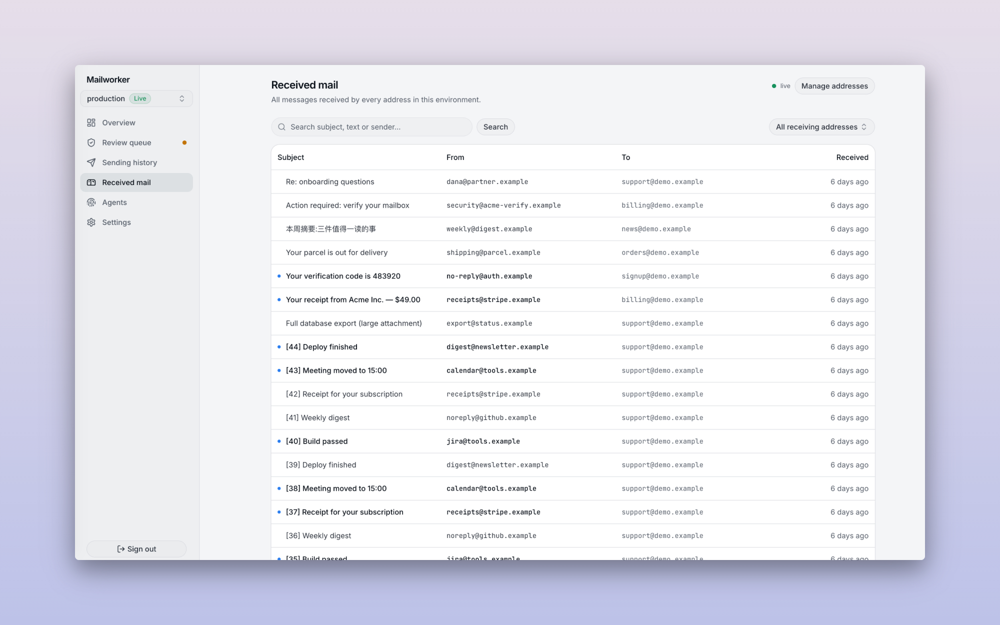

<div align="center">

# Mailworker

### 产品负责发送，Agent 负责处理，你负责最终批准。

**基于 Cloudflare Email Service + Workers，为 AI Agent 打造的自托管邮件运行时。**

[English](README.md) · [一条 Prompt 部署](#用一条-prompt-部署) · [REST API](#让产品接入邮件能力) · [CLI](#给-agent-一个收件箱)


</div>

独立开发者如何利用 AI Agents 管理邮件？Mailworker 把你的 Cloudflare 域名变成一套
同时服务于产品和 Agent 的邮件基础设施：产品通过类似 Resend 的 REST API 收发事务性
邮件；Agent 通过 CLI 创建收件箱、等待邮件、读取正文、撰写回复，并把发送动作提交给
人类审批。

一个部署可以托管多个产品和域名，不需要为每个产品或域名单独购买 Mailworker 订阅。
基础设施、邮件数据和凭证始终留在**你自己的 Cloudflare 账号**中；Cloudflare 套餐及
实际用量费用仍然适用。



## 把邮件运维交给 Agent 闭环

| 你的需求 | Mailworker 提供什么 |
|---|---|
| **为每个产品接入邮件** | 一套 REST API 管理多个域名的事务性收发，支持附件、批量发送、Webhook 和投递时间线 |
| **让 Agent 协助客服** | Agent 把邮件当作不可信数据读取、撰写回复并提交审批；人类在 Dashboard 中批准这个不可撤销的发送动作 |
| **E2E 与人工测试** | 在自己的域名上按需创建临时邮箱，无需为每个地址新增 Cloudflare 路由规则；阻塞等待邮件到达并读出正文 |
| **自己掌控控制面** | 限定权限的 API Key、Agent 身份、配额、收件人白名单、退信抑制、环境隔离，以及绝不向外发信的 Sandbox |

```text
客户邮件 ──▶ Cloudflare Email Routing ──▶ Mailworker ──▶ Agent 阅读并撰稿
                                                                    │
产品 API ──▶ REST API / CLI ─────────────▶ 策略闸门 ─────▶ 人工批准
                                                                    │
收件人 ◀─── Cloudflare Email Sending ◀── 投递队列 ◀────────────────┘
```

## 用一条 Prompt 部署

Mailworker 没有一个托管平台等你注册。直接在编码 Agent 的会话中 Clone 仓库，然后让它
把项目部署到你的 Cloudflare 账号：

```bash
git clone https://github.com/guangzhengli/mailworker.git
cd mailworker
pnpm install
```

```text
帮我部署这个项目到我的 Cloudflare 上。
```

仓库内置的 `deploy-mailworker` Skill 会依次经过 environment、discovery、plan、execute
四个阶段。**在你批准计划之前，它不会产生任何变更。**计划会列出 D1、R2、Queues、
Durable Object、Worker、Email Routing、Email Sending、投递事件、DNS 以及初始化 Admin Key。

如果你的 Agent 不会自动发现仓库内的 Skill，可以显式安装：

```bash
npx skills add guangzhengli/mailworker -s deploy-mailworker
```

你也可以直接阅读
[`.agents/skills/deploy-mailworker/`](.agents/skills/deploy-mailworker/SKILL.md)
里的每一步，然后手动执行。

## 给 Agent 一个收件箱

在 Codex、Claude Code、Cursor 或其他兼容
[Agent Skills](https://agentskills.io) 的 Agent 中安装 Mailworker Skill：

```bash
npx skills add guangzhengli/mailworker
```

也可以不 Clone 仓库，直接使用 CLI：

```bash
npx @mailworker/cli@latest help --agent
```

一个完整的注册流程测试只需要两个操作：

```bash
id=$(mailworker inbox create --prefix signup --ttl 10m --json | jq -r .id)

# 触发注册流程后等待邮件；stdout 里只有正文本身。
BODY=$(mailworker wait --inbox "$id" --text --timeout 60s) || exit $?
```

创建一个收件箱只是一次数据库写入，不会调用 Cloudflare API，也不会新增路由规则。
你可以为每个测试创建独立邮箱，让它自动过期；也可以把失败邮件保存成原始 `.eml`，以后
通过同一条接收链路重放。

| 命令 | 用途 |
|---|---|
| `capabilities` | 查询当前 Key 的环境、身份、限制和可执行操作 |
| `inbox create` / `inbox ls` / `inbox rm` | 创建和管理临时或持久邮箱地址 |
| `wait` / `tail` | 等待匹配邮件，或持续读取新邮件 |
| `ls` / `get` / `seen` | 搜索和读取邮件；`--text` 只输出正文，`--raw` 导出原始 MIME |
| `inject` | 沿真实接收链路重放捕获的 `.eml` Fixture |
| `send` / `status` | 经过策略闸门发送，并查看完整投递时间线 |
| `approve` | 放行等待人类审批的邮件；不应把这项权限交给 Agent |
| `doctor` | 检查 MX、SPF、DKIM、DMARC、发信状态和 Bindings |

所有命令都支持 `--json`，在非 TTY 环境中绝不弹出交互，并使用稳定的退出码。例如，
`wait` 没等到匹配邮件时返回 `4`，Agent 和 CI 无需解析文案即可分支处理。

TypeScript 应用可以使用 `@mailworker/sdk`。它会在运行时校验响应，支持有界异步分页
和取消请求，并且只有在幂等键能够保证安全时才会自动重试写操作。

## 让产品接入邮件能力

CLI 只是同一套 `/v1` REST API 的轻量客户端。你的产品可以用任何语言携带限定权限的
Key 调用 Mailworker：

```bash
curl -sS -X POST "$MAILWORKER_URL/v1/send" \
  -H "Authorization: Bearer $MAILWORKER_TOKEN" \
  -H "Content-Type: application/json" \
  -d '{
    "from": "support@mail.example.com",
    "to": ["customer@example.com"],
    "subject": "我们已收到你的请求",
    "text": "稍后将由人工继续跟进。",
    "idempotencyKey": "ticket-1842-reply-1"
  }'
```

`202` 响应会返回 Delivery ID，而不是承诺邮件已经送达。通过
`GET /v1/send/:id` 查询事件时间线，或订阅签名 Webhook。通过
`POST /v1/inboxes` 为产品或测试创建邮箱，通过 `GET /v1/messages/wait`
长轮询等待入站邮件。

临时邮箱默认静音。用 `mailworker inbox create --persistent --muted`
创建长期使用的静音地址，高流量来信就不会进入主收件箱。用 `mailworker update`
或 `PATCH /v1/messages` 修改已读、星标、归档状态及标签，用 `mailworker note`
或 `POST /v1/messages/:id/notes` 留下纯文本备注。

完整接口见 [REST API 参考](skills/mailworker/references/rest-api.md)。

## 人工审批是一条安全边界

Agent 可以读取邮件、生成回复并调用 `send`，同时它的身份被配置为
`require-approval`。Delivery 会停在 `pending_approval`，直到另一个主体在 Dashboard
中批准，或使用拥有 `message:approve` 权限的凭证放行。

这种职责分离是有意设计的：

- 发信 Agent 受到配额、收件人白名单和最小权限范围的约束。
- Agent **没有** `message:approve`，不能审批自己的工作。
- 幂等 Key 防止重试时重复发送同一封邮件。
- 循环检测、退信抑制和按身份执行的策略闸门会在投递前运行。
- 入站邮件永远是不可信数据。`trusted` 只代表发件域可归因，绝不代表“这是 Agent
  可以遵循的安全指令”。

开发环境可以设为 `sandbox`：策略、状态机和归档照常运行，随后把邮件字节回环到本地
收件箱。没有邮件抵达真实用户，但 `mailworker wait` 仍然可以完成。

## 当前状态与限制

> [!WARNING]
> **Mailworker 目前处于 Alpha 阶段。欢迎搭建和试用，但请先测试、审查，再考虑依赖。**
>
> - Cloudflare Email Sending 目前仍处于 Public Beta，不建议现阶段把 Mailworker
>   直接作为生产邮件基础设施。
> - 请先使用一个干净的测试域名或子域名，确保它的 MX 记录没有承载你在意的邮件；
>   暂不推荐第一次就绑定主域名。
> - Mailworker 和 Cloudflare Email Service 面向事务性邮件与 Agent 邮件，不具备
>   Newsletter、Campaign 或批量营销邮件能力。

入站 Email Routing 可用于 Workers Free 与 Paid 套餐。向任意收件人发信需要 Workers
Paid；Cloudflare 目前每个账号每月包含 3,000 封出站邮件，随后按量收费。新账号也会从
较保守的每日发信额度开始，再随信誉增长。部署前请查看 Cloudflare 最新的
[价格](https://developers.cloudflare.com/email-service/platform/pricing/)与
[限制](https://developers.cloudflare.com/email-service/platform/limits/)。

## 它是如何构建的

```text
Email Routing ─▶ email() ─▶ MIME 解析 ─▶ D1 有界元数据/索引 + R2 完整正文/原始邮件/附件
                                           │
REST API / CLI ─▶ 领域服务 ─▶ Queues ──────▶ Email Sending
                       │                    └─▶ 签名 Webhook + 投递事件
                       └─▶ Durable Object 协调 wait / WebSocket 更新
```

| 路径 | 职责 |
|---|---|
| `packages/core` | 领域服务、策略、Ports 和内存适配器 |
| `packages/mime` | MIME 解析与构建，以及安全的 HTML 展示 |
| `packages/contract` | 共享 Zod Schema 与 API DTO |
| `packages/cli` | 已发布、面向 Agent 的 CLI |
| `packages/sdk` | 带运行时校验、安全重试和有界分页的 TypeScript SDK |
| `apps/web` | Worker 入口、REST API、队列、持久化和 Dashboard |

<details>
<summary><strong>本地开发</strong></summary>

```bash
pnpm install
pnpm check

cd apps/web
echo 'MAILWORKER_ADMIN_KEY = "local-dev-admin-key"' > .dev.vars
pnpm db:migrate:local
pnpm dev
```

API 和服务端渲染的 Dashboard 会在 workerd 中运行，并使用 `wrangler.jsonc` 中的
Bindings。打开 `/login`，使用上面的本地 Admin Key 登录。

</details>

<details>
<summary><strong>更新已有部署</strong></summary>

```bash
pnpm ship
pnpm ship --dry-run
```

Ship 命令会规划迁移顺序、记录回滚目标、构建、部署并执行冒烟测试。第一次配置仍然交给
带审批关卡的 `deploy-mailworker` Skill。

</details>

## 参与贡献

欢迎提交 Issue 和 Pull Request。发起 PR 前请运行 `pnpm check`。测试套件会对内存适配器
和 workerd 中真实的 D1/R2 适配器运行同一组 Repository Conformance 断言；架构依赖规则
同样由测试强制执行，而不只是一条约定。

## 许可证

[MIT](LICENSE)
